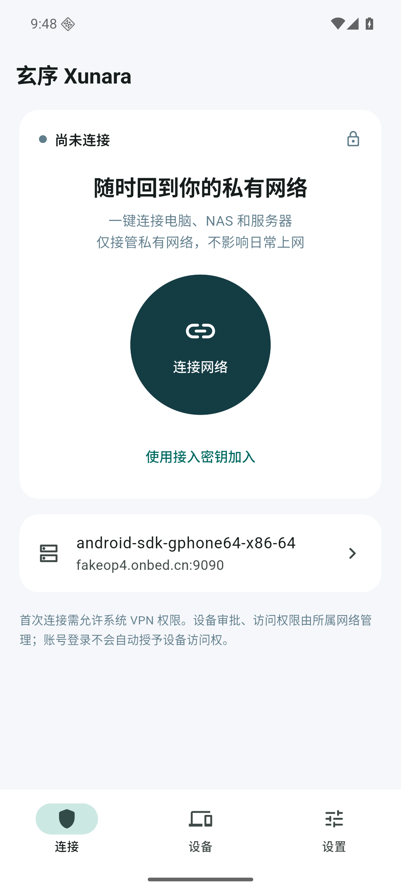
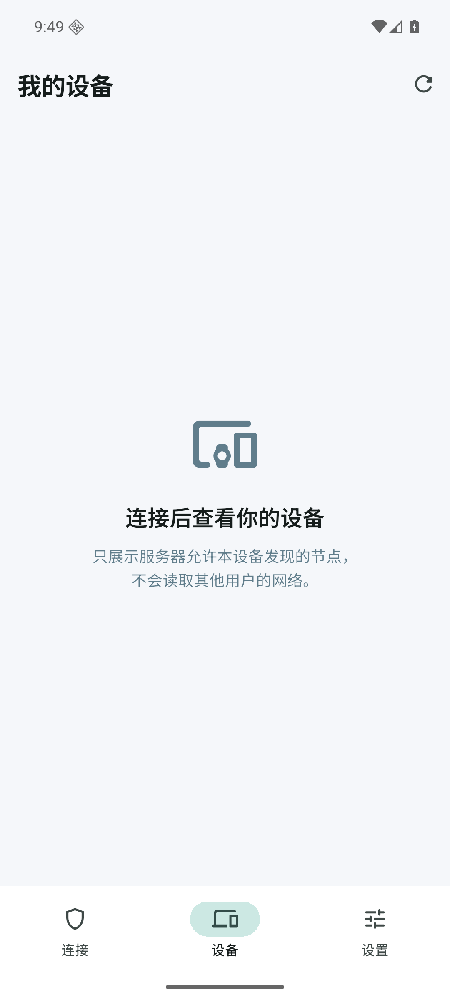
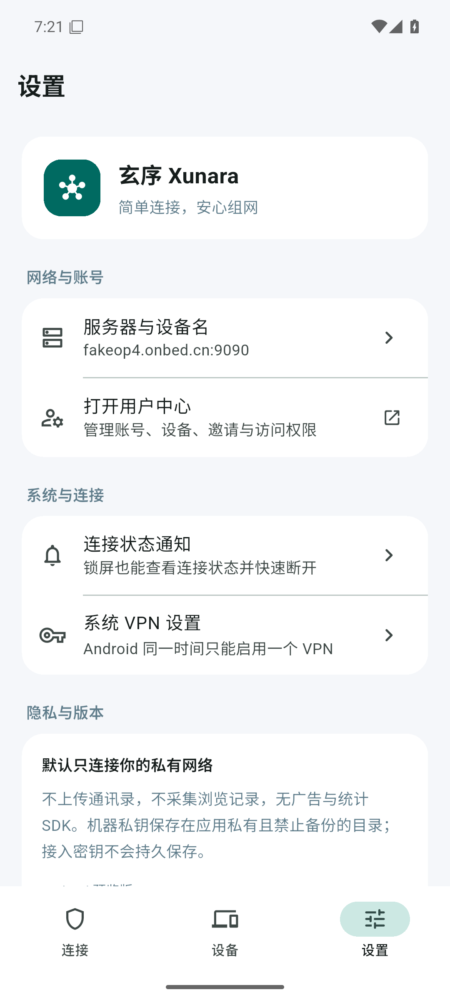
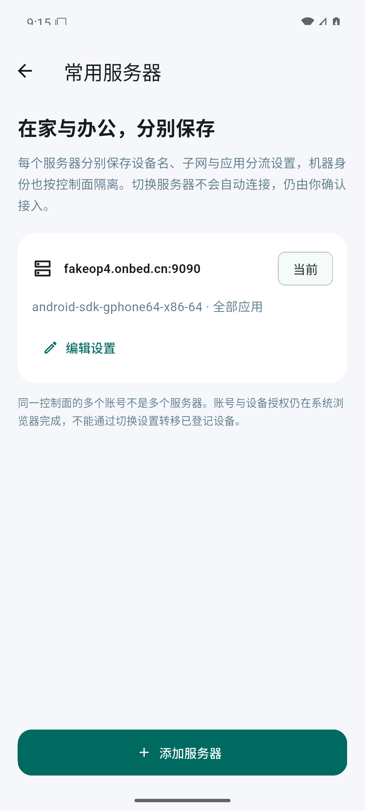
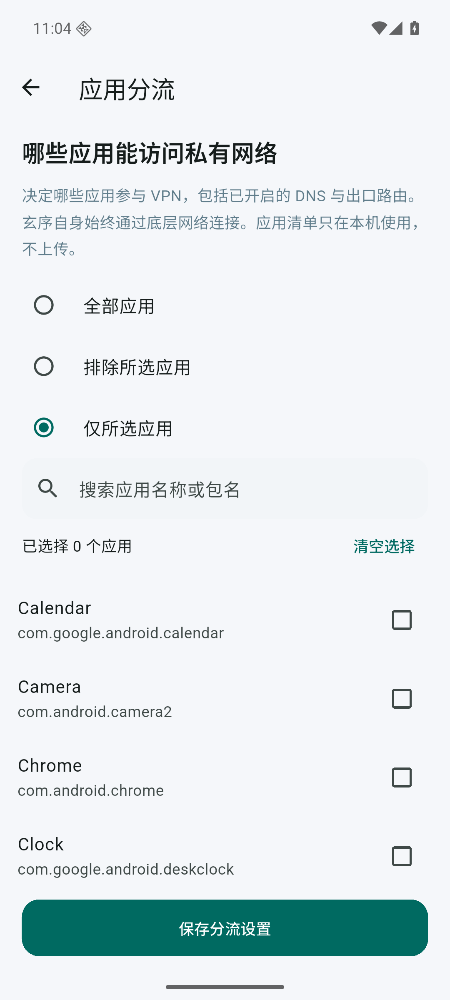
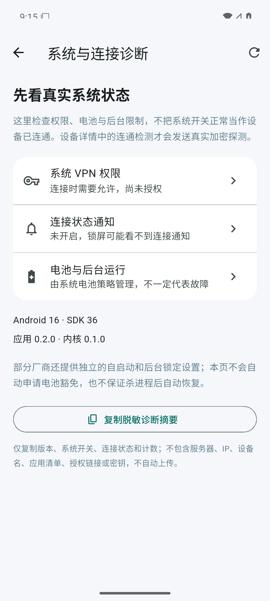
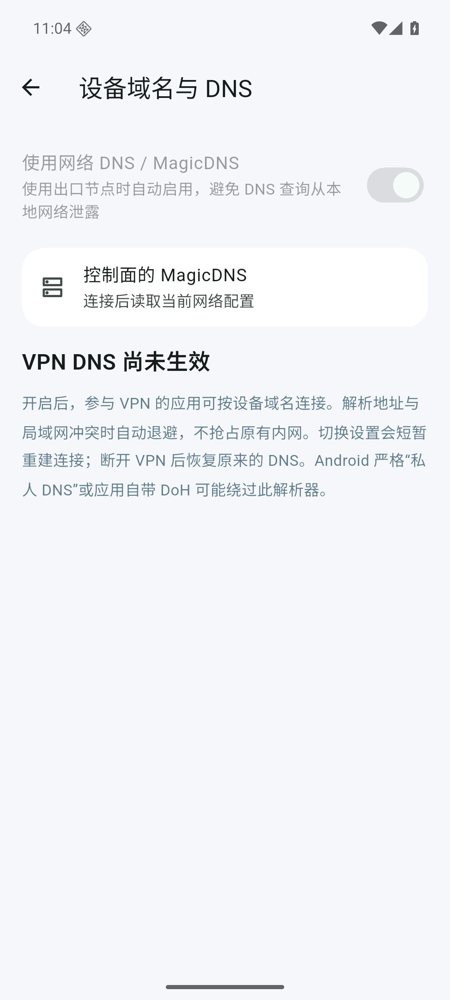
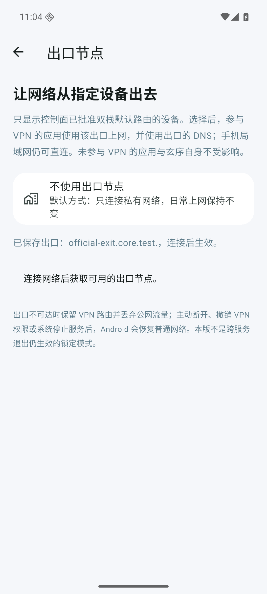
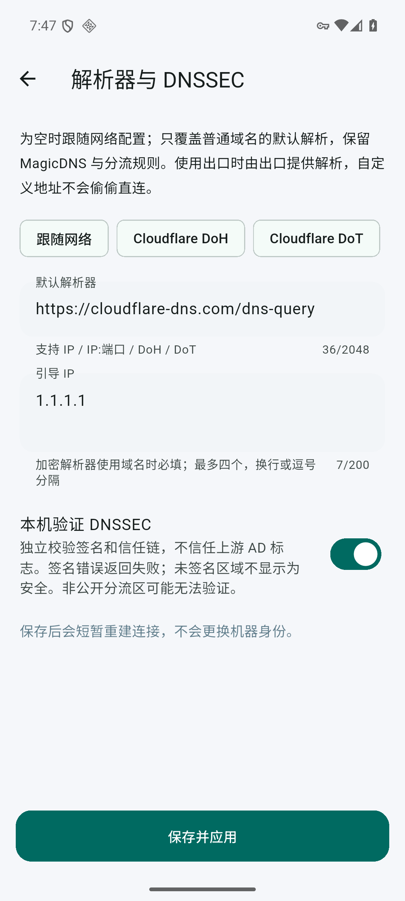

# 玄序 Android · Xunara

独立的 **Flutter 安卓客户端**，不是 WebView 套壳，也不要求先安装官方 Tailscale App。中文界面、底部「连接 / 设备 / 设置」、单手操作、简洁卡片；组网复用独立 [xunara-client](https://github.com/xunara-net/xunara-client) 的 Rust 内核。

**当前为测试预览版，不是完整替代官方客户端的正式发行版。** 支持 Android 8.0+、ARM64 / x86_64。APK 下载见 [Releases](https://github.com/xunara-net/xunara-android/releases)，安装前对照同版本 `SHA256SUMS`。预览包使用测试签名，不承诺跨 CI 构建直接覆盖安装；正式发布前需配置长期维护的私有签名。

`0.5.2` 修正已复现的单向 UDP 直连误判：收到请求不再无限续期失效的回程，探测过期或本地 UDP 发送错误时回退同一设备的加密 DERP。**作为出口的手机也必须更新，建议两端覆盖升级**，不要卸载或清除机器身份。该修复有隔离网络回归，不等于已验证所有真机；指定手机的现网恢复仍需升级后实测。

`0.5.4` 更新 Rust 内核至 `82109c5`：不再把不可达的首个中继固定上报为本机 home，仅发布通过身份握手和随机心跳的连接，断线后有界重选。隔离测试已复现旧版的回包黑洞并验证修复；不等于已经确认原物理手机恢复。**两端均用玄序时都覆盖升级，不卸载、不清数据；出口用官方 Tailscale 时可保留官方，只更新玄序使用端。** 具体源码对照和测试边界见[核心审计记录](https://github.com/xunara-net/xunara-client/blob/main/docs/exit-path-audit.md)。

同版还修复了后台蜂窝退出导致当前 Wi-Fi 上的 VPN 无端重建：保留全部 LAN / DNS 冲突保护，只比较实际影响连接与路由规划的状态。问题证据、兼容边界和测试记录见 [0.5.4 出口审计](docs/exit-relay-fix.md)。

`0.5.5` 使用 `22d0d5b` 内核，补齐设备在线 / 离线 / 未知和最近在线；已知离线出口不可新选，已有选择不会自动切换。修复已连接出口的 DNS 等待预算、严格关联的 ICMP 错误回包和未知 home 时的已认证中继回程，诊断分别统计真实 DNS 消息与数据包。官方 Android `1.98.8` 与玄序已完成双向出口的 DNS、验证证书的 HTTPS 和实际 Chrome 页面测试；这些是专用模拟器结果，不代表原物理手机已恢复。详见 [0.5.5 混合测试记录](docs/exit-presence-interop.md)。

在「设置 → 系统与连接诊断 → 复制诊断摘要」可取得应用版本、出口 / DNS 实际状态、
连接代次、重连次数、本机中继连接确认及白名单数据包计数；不导出服务器、IP、设备名称、出口身份或密钥。
复制前先尝试一次访问网页，保留失败时的连接。计数缺失显示未知，不假装零丢包。

`0.5.6` 对齐出口宿主 DNS、解析器竞争与系统 DNS 地址退避。隔离模拟器已复现旧版“IP 可访问、域名超时”，同身份覆盖新版后恢复公网解析与 MagicDNS；最终 Release 与官方 Android 的出口混测通过。**两台均用玄序时请都覆盖更新**，不要卸载或清数据；原物理手机仍需复测。详见 [DNS 修复与验收](docs/magicdns-fix.md)。

`0.5.7` 的 DNS 页参考官方 Android，显示实际配置的解析器、搜索域、分流域和启用状态，不再将内部 VPN 监听地址展示成 DNS 服务器。诊断增加 DNSSEC 保存 / 实际启用状态。**这是展示与诊断改进，不代表原物理手机的解析故障已修复**；真机排查与系统解析回归进度见同一[验收记录](docs/magicdns-fix.md)。

`0.5.8` 修复隧道 DNS 的 TCP 连接清理：旧版完成查询后仍占用出口连接额度，短时间连续解析会阻塞后续 DNS。旧内核已在真实双安卓测试中复现“少量查询正常，连续查询超时”，并非仅有界面调整。修复保留配额、ACL、固定出口、TLS 和 DNSSEC；原手机仍需覆盖安装后验收，见[连接清理记录](docs/magicdns-fix.md)。

`0.5.10` 修复出口业务连接占满后连带阻塞 DNS 的问题，分离两类有界额度，并补齐已确认直连的三秒保活。诊断增加容量拒绝和路径确认计数。**提供出口的手机也需要更新**；只更新使用端不能修复旧出口的额度逻辑。上轮模拟器能打开网页仍遗漏了混合负载下的失败，不能据此声称原手机已恢复。复现、源码对照和安装包验收见[DNS 记录](docs/magicdns-fix.md)。

<p>
  
  
  
</p>

<p>
  
  
  
</p>

<p>
  
  
  
</p>

截图来自实际 Release APK 的 Android 模拟器，不含伪造设备或连接数据。

## 已实现

- 原生 Android VPN 权限、前台服务、通知栏状态与断开操作，Flutter 退出前台不影响内核工作。
- 官方兼容 TS2021 / Noise 设备注册与网络映射；浏览器登录和设备审批，或临时接入密钥加入。
- WireGuard 加密、UDP 直连探测、Disco、STUN、私有 DERP 的 TLS / 证书指纹校验和回退。
- 已授权设备发现、名称 / IP 搜索、IP 复制、在线 / 离线 / 未知、最近在线、直连探测状态与中继区域详情；在线只表示控制面连接报告，不等于业务可达。
- 设备详情补充操作系统、控制面域名、密钥到期时间、已批准子网和中继名称；检测按钮发送真实加密 ICMP，显示实际回包路径与 RTT，明确提示超时 / 不可见设备。
- 接收已批准的远程子网路由、ACL 检查、真实发送 / 接收计数。
- 本机仅安装 host address；冲突时保留手机局域网、跳过重叠远程路由。默认不接管出口或手机 DNS，用户可单独启用。
- 私有且禁止备份的机器身份，按账号配置隔离持久化；同一控制器多账号也不复用设备私钥。
- Wi-Fi / 移动网络切换、断网恢复后自动重连：先退出旧 TUN，再重新检查 LAN / DNS 冲突，沿用机器身份、不保存或重放接入密钥。主动断开会取消待重连任务；可在网络设置关闭自动重连。
- 可选 VPN DNS：MagicDNS A/AAAA/PTR、额外 IP 记录、搜索域、分流与全局 IP 解析器；DNS 地址冲突自动退避，支持 UDP / TCP 查询。
- DNS 页右上角可配置 DoH / DoT、引导 IP 与本机 DNSSEC 验证；保留 MagicDNS / 分流，签名或加密失败不回退明文。系统诊断新增私人 DNS 状态与系统网络设置入口。
- 内核按服务端提供的 peer 专属地址提示完成共享 masquerade，保留租户隔离与 ACL；不把共享变成全局设备管理。
- 「设置 → 共享本机网络」支持免 Root 提供子网和出口，实际转发双栈 TCP / UDP / ICMP Echo；只有请求、批准与 ACL 同时允许才生效。撤销权限关闭旧流，出口另提供 WireGuard 内的 peerapi DNS。
- 可选择已批准的出口节点，转发 IPv4 / IPv6 公网流量并通过该出口的 peerapi 加密解析 DNS。出口撤销时保留 VPN 内的阻断，不自动直连或切换其他出口。
- 账号与控制器列表：每项保留设备名、DNS、出口、重连和应用分流偏好。切换先结束旧连接，不自动接入；移除记录不撤销服务器设备。
- 应用分流支持全部应用、排除所选、仅所选三种模式，对私网、已开启的 DNS / 出口均生效。仅所选清单全部卸载时拒绝建立 VPN，不回退成全部应用。
- 系统诊断读取 VPN 权限、通知、电池和后台限制，支持手动复制不含服务器、IP、设备名、应用清单或凭据的诊断摘要；不上传日志。
- 系统通知设置、VPN 设置和浏览器用户中心入口，不复制一套臃肿的管理后台。

## 怎么使用

1. 安装 ARM64 APK（主流安卓手机）；x86_64 包用于相应设备 / 模拟器。
2. 默认服务器为 `https://fakeop4.onbed.cn:9090/`。连接其他部署可在「设置 → 账号与控制器 → 添加其他控制器」填写根地址，**没有网络标识、登录范围或 `/t/用户名/login`**。
3. 点「连接网络」并允许 Android VPN；首次接入点「前往浏览器登录并授权」，登录自己的账号并批准这台设备。返回 App，收到授权映射并建好真实 TUN 后才显示「已安全连接」。
4. 免交互接入可选「使用接入密钥加入」，粘贴从自己用户中心生成的设备接入密钥；不会保存该密钥。
5. 访问远程子网：在网络管理中批准路由、配置允许访问的 ACL，再保持「访问远程子网」开启。
6. 在「设置 → 账号与控制器」添加同地址的另一个账号或其他控制器；首次连接分别授权。备注不是登录身份，请在浏览器授权页确认实际账号。
7. 在「设置 → 应用分流」选择能访问私网的应用，保存后再连接。只显示当前 Android 用户可启动及先前已选择的应用；不申请读取全部软件包的权限。Android 按 UID 分流，共享 UID 的应用可能一起生效。
8. 后台或通知异常时打开「系统与连接诊断」。系统开关正常不代表业务可达，需到设备详情发送实际加密探测。
9. 使用设备域名：先在用户中心启用本网络的 MagicDNS，再在 App「设备域名与 DNS」开启网络 DNS。想通过其他设备上网：先连接获取列表，再在「出口节点」选择；调整会短暂重建连接，不再次保存或索取接入密钥。
10. 加密解析：在「设备域名与 DNS」右上角打开「解析器与 DNSSEC」，填写 DoH / DoT 和引导 IP，可单独开启本机 DNSSEC 验证。使用出口时仍由出口解析；严格私人 DNS 可到「系统与连接诊断」检查。

账号登录不改变已登记机器的归属，不能靠切换浏览器账号接管另一用户的设备。添加账号配置会创建新设备；切回原配置继续使用原身份。请勿清除应用数据来代替服务端撤销设备。

Android 同时只能运行一个 VPN。网络环境改变时，默认安全退出旧隧道并自动重连，不沿用可能截走新 LAN 的旧路由；完全断网时通知栏显示等待网络恢复。主动断开、撤销权限、关闭自动重连后不会擅自重新连接。首次注册未完成时不自动重放接入密钥。前台服务仍可能受到部分厂商后台限制，需结合真机电源管理实测；本版不承诺被系统杀进程、重启手机后自动拉起 VPN。

## 当前边界

- 完整 Tailnet Lock、文件传输和自动升级尚未完成；不会放一个无效开关冒充支持。Tailnet Lock 启用时明确拒绝未实现的本机签名链验证。
- DNS 支持 IP / IP:端口、HTTPS DoH、TLS DoT 和本地 DNSSEC。域名形式的加密解析器须配置引导 IP；HTTPS 不接受 URL 凭据、query、重定向或分块响应。出口模式固定使用出口 peerapi，不把自定义解析器偷偷发到手机原网络。
- DNSSEC 不照抄上游 AD，MagicDNS 本地记录不冒充签名；非公开分流区可能无法验证。系统私人 DNS 提供检测 / 设置引导，第三方应用任意 HTTPS DoH 不能在不破解证书的前提下透明强制改写；不会通过中间人证书绕过应用安全。
- 出口模式保留 LAN 且强制 VPN DNS；所选出口失效时不回退。主动断开、系统停止 / 撤销 VPN 或进程退出后，Android 会恢复普通网络；这不是跨进程退出仍生效的锁定模式。玄序自身与被排除的应用不走出口。
- 手机可明确选择提供子网 / 出口，但不修改内核转发，不是二层桥接。转发受物理网络能力及系统 ICMP 权限约束，有连接数、速率和空闲超时限制；参见 [手机网络共享](docs/phone-forwarding.md)。
- 外层 UDP 目前使用 IPv4；隧道可传 IPv4 / IPv6 的 TCP、UDP、ICMP，不支持 IP 分片或 IPv6 扩展头。最多 256 个可见节点。
- 「中继候选」表示内核配置的回退路径，不伪报对端在线或已测速。STUN 不是 UDP 业务中继。
- 人类账号 / OAuth Session 留在系统浏览器；App 没有平台管理员令牌，不自动继承浏览器登录权限。
- 控制面必须使用可信 HTTPS，只有回环 HTTP 可用于隔离测试；没有“忽略证书校验”。私钥在 Android 应用私有文件中，并非硬件 Keystore 不可导出密钥。

## 本地构建

固定工具：Flutter **3.47.7** / Dart **3.13.5**、JDK 17、Android SDK 36、NDK **29.0.14206865**、Rust **1.98.1**。原生脚本当前面向 Linux x86_64 开发机，不将本机绝对路径提交到 Git。

```sh
export ANDROID_HOME="$HOME/Android/Sdk"
flutter pub get
rustup target add aarch64-linux-android x86_64-linux-android
sh scripts/build-native.sh
flutter build apk --release --target lib/main.dart \
  --target-platform android-arm64,android-x64 --split-per-abi
```

Rust 依赖固定到独立仓库的具体 commit，`Cargo.lock` / `pubspec.lock` 一起提交。`jniLibs` 是生成物，不纳入 Git；缺少任一默认 ABI 的内核时 Gradle 会明确失败，不生成只有界面的空壳安装包。NDK ELF 使用 16 KiB LOAD alignment。

`scripts/collect-native-notices.sh` 同步原生组件的原始声明，随 APK 打包，可在「设置 → 开源组件声明」查看；清单受 Cargo 锁文件约束。

## 验证

```sh
dart format --output=none --set-exit-if-changed lib test integration_test
flutter analyze
flutter test test
node --test scripts/check-jni-contract.test.cjs
(cd native && cargo fmt --check && cargo clippy --locked --all-targets -- -D warnings && cargo test --locked --all-targets)
flutter build apk --debug
(cd android && ./gradlew :app:testDebugUnitTest :app:lintDebug)
```

发布前必须对最终混淆 APK 验证 JNI 回调，不能以 Debug 连接或 Release 页面检查代替：

```sh
flutter build apk --release --target-platform android-arm64,android-x64 --split-per-abi
node scripts/check-jni-contract.cjs build/app/outputs/flutter-apk/app-arm64-v8a-release.apk
node scripts/check-jni-contract.cjs build/app/outputs/flutter-apk/app-x86_64-release.apk
```

0.3.0 发布包漏保留 `dnsServers()`，会在连接时显示 `Java exception was thrown`；
0.3.1 修复该混淆规则，并由 CI 检查两个 ABI 的实际 DEX。升级请使用同签名覆盖安装，
保留原账号与机器身份，不要卸载或清除数据。

真实 VPN 测试先在相邻目录准备 `xunara-client` 和其 `tests/compat` 所需固定版本的 `xunara-server`：

```sh
(cd ../xunara-client && cargo build --locked)
(cd ../xunara-client/tests/compat && go build -race -o ../../target/compat-fixture .)
sh scripts/test-android-vpn.sh emulator-5580
```

具备公网 443 / 853 连通条件时，可用 `XUNARA_TEST_PUBLIC_DNS=true sh scripts/test-android-vpn.sh emulator-5580` 验收手机真实 DoH / DoT、DNSSEC 签名链与错误签名拒绝；默认隔离测试不依赖公网 DNS。`XUNARA_TEST_PHONE_ROUTER=true` 验收官方 tsnet 经手机转发；`XUNARA_TEST_SHARING=true` 验收三租户重叠原地址共享、ACL / 子网隔离和撤销，可合并开启。不能把协议向量或普通组网回归冒充为共享验收。

手机转发专项另检查同一域名的不可达 IPv6 与可用 IPv4：强制 IPv6 拨号必须失败，默认双栈连接应经该手机出口回退 IPv4 并取得真实 HTTP 响应，防止提前 SYN-ACK 把故障拖到 TLS 阶段。该项由官方 tsnet 发起，不使用 App 自己已绕过 VPN 的请求假装通过。

需先启动专用 Android 模拟器，并安装 `socat`、`jq`、`iproute2`；宿主机允许 rootless user / network namespace。测试只允许 `emulator-*`，不自动给真机授权。测试服务运行在隔离 namespace，宿主代理只监听 127.0.0.1，Auth Key 通过 stdin 写入应用私有缓存，不出现在 argv、URL 或 APK 中，不访问生产账号。

测试验证的是其他 Android UID 发起的真实 TUN / ICMP / TCP / ACL / DERP / 子网流量，而非 App 自己从被排除的网络请求制造“组网成功”。与官方 Go tsnet 的双向兼容、直连 / DERP 切换由 Rust 内核仓库的真实 Linux 网络测试覆盖；不能把它说成 Android 真机已验收。

扩展验收会切换专用模拟器的 Wi-Fi / 移动数据开关，并在隔离 namespace 暂停 ICMP 回复，验证诊断实际超时、断网移除旧 VPN、Wi-Fi 恢复 / 模拟移动网络切换后的自动重连和 TCP / 子网恢复，以及主动断开后不再自动连接。结束时恢复模拟器原有开关并停止测试 App；不要在个人工作模拟器上运行。此过程不要求安装包取得 root。

详见 [架构和安全边界](docs/architecture.md)、[验收记录](docs/verification.md)、[安全反馈](SECURITY.md)。

0.3.0 一次性将旧单服务器 / catalog_v1 迁移到 catalog_v2，保留原控制器哈希身份目录，新账号使用独立随机目录；旧键成功提交后删除。配置损坏时拒绝覆盖，不能用清除应用数据代替修复或服务端撤销。回滚必须保留新配置读取能力，详见[DNS、出口与多账号设计](docs/dns-exit-accounts.md)。

### 获授权的现网出口诊断

`integration_test/live_exit_test.dart` 只用于操作者明确授权的现网采集，不进入生产 `lib/main.dart` APK。通过 stdin 将单独签发的短期临时设备密钥写入应用私有的 `cache/live-exit-auth-key`，配置写入 `cache/live-exit-settings`，字段为 `server`、`hostname`、全新 UUID `profile_id`、指定出口的 `exit_id`。只接受 HTTPS 根地址和 `diag-` 诊断设备名，禁止复用已有配置 ID 或用户机器私钥。

测试建立真实 TUN 并选择指定出口，将不含授权链接的状态与 ICMP 结果写入 `cache/live-exit-*`，等待外部普通 UID 请求实际公网 IP、VPN DNS 和 HTTPS，再以 `cache/live-exit-finish` 结束采集。**采集测试退出成功不等于出口可用**：业务结果必须以这些外部请求及实际探测结果为准，不能用 App 自身豁免 VPN 的请求或绿色连接状态代替。

配置可增加 `select_after_connect: true`，通过页面实际使用的 `AppController` 先普通接入，
再停止旧 VPN、保存出口设置并重新连接，覆盖先连接后选择出口的完整生命周期。
外部探针必须核对 `adb shell id -u` 为 `2000`、可执行权限和 Android 系统 CA，并观察
真实 TUN / DNS / 加密收发计数增长。root shell、绕过 VPN 的 App 请求、探针未执行或
只有连接状态均不能计为业务通过。普通回归脚本在 root adbd 下直接拒绝开始。

只在专用模拟器运行并预先核对签名、备份原 APK / 偏好；结束恢复原内容，仅删除本轮 UUID 的临时身份目录，以及控制面中本轮确切的临时节点 / 密钥。不得卸载原应用、清除全部数据、撤销其他会话或改动真实出口的批准路由。
